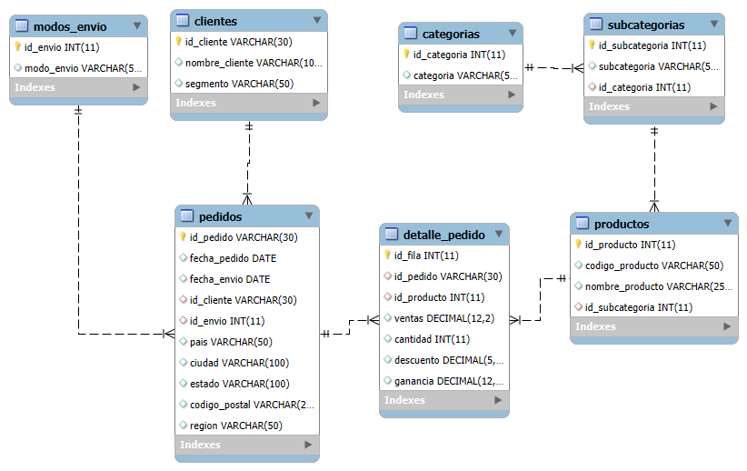

# Trabajo Final — Bases de Datos II y Gestión de Proyectos

## Base de datos Superstore

> **Proyecto académico:** diseño, normalización y consultas de una base de datos relacional sobre ventas minoristas.

> **Integrantes:** Fain, Selena - Sotelo Facundo.

> **Institución / curso:** Escuela Superior de Comercio N°43 - 3er Año.

## 1. Descripción y objetivo

El proyecto utiliza un conjunto de datos de **Superstore**, con información sobre pedidos, clientes, productos, envíos, ubicaciones y resultados de ventas en Estados Unidos. La tabla de origen, `Superstore`, contiene **9.994 filas**.

**Archivo original:** [Ver Superstore.csv](entrega/datos/Superstore.csv)

El objetivo es organizar los datos en tablas relacionadas y realizar consultas SQL para analizar las ventas.

También se conserva la tabla original `Superstore` para cargar y comparar los datos.

## 2. Herramientas utilizadas

- **MariaDB 10.11:** servidor de base de datos.
- **Docker y Docker Compose:** ejecución de MariaDB en un contenedor.
- **HeidiSQL:** creación, importación, exportación y consultas de la base.
- **MySQL Workbench:** elaboración del diagrama de relaciones.
- **Visual Studio Code, Git y GitHub:** archivos, documentación y control de versiones.


## 3. Análisis de los datos originales

El CSV contiene columnas como `Row_ID`, `Order_ID`, `Order_Date`, `Ship_Date`, `Ship_Mode`, `Customer_ID`, `Customer_Name`, `Segment`, `Country`, `City`, `State`, `Postal_Code`, `Region`, `Product_ID`, `Category`, `Sub_Category`, `Product_Name`, `Sales`, `Quantity`, `Discount` y `Profit`.

El archivo repite datos de clientes, pedidos y productos en varias filas. Para reducir esa repetición, se separó la información en tablas relacionadas.

Como algunos códigos `Product_ID` aparecen con distintos nombres, se usa `id_producto` como clave primaria y se guarda también el código original.

## 4. Diseño de tablas

El modelo comprende **siete tablas relacionadas**, más una tabla cruda:

| Tabla | Función | Identificador principal |
|---|---|---|
| `clientes` | Clientes y segmento | `id_cliente` |
| `categorias` | Categorías de productos | `id_categoria` |
| `subcategorias` | Subcategorías y categoría a la que pertenecen | `id_subcategoria` |
| `productos` | Productos y su subcategoría | `id_producto` |
| `modos_envio` | Formas de envío | `id_envio` |
| `pedidos` | Cabecera del pedido, cliente, envío, fechas y ubicación | `id_pedido` |
| `detalle_pedido` | Líneas de venta: producto, cantidad, ventas, descuento y ganancia | `id_fila` |
| `Superstore` | Datos originales para la carga y verificación | `Row_ID` (identificador de origen) |

### Relaciones principales

- `categorias` **1:N** `subcategorias`.
- `subcategorias` **1:N** `productos`.
- `clientes` **1:N** `pedidos`.
- `modos_envio` **1:N** `pedidos`.
- `pedidos` **1:N** `detalle_pedido`.
- `productos` **1:N** `detalle_pedido`.

La tabla `detalle_pedido` relaciona pedidos y productos: un pedido puede incluir varios productos, y un producto puede aparecer en distintos pedidos.

## 5. Diagrama entidad-relación

El diagrama refleja las tablas y sus relaciones PK/FK.



## 6. Creación de la base de datos y sentencias DDL

Las sentencias DDL permiten crear la base de datos y sus tablas.

```sql
CREATE DATABASE IF NOT EXISTS clientes_supermercado_completa;
USE clientes_supermercado_completa;
```

Ejemplo simplificado de la definición de categorías y subcategorías:

```sql
CREATE TABLE categorias (
  id_categoria INT NOT NULL AUTO_INCREMENT,
  categoria VARCHAR(50),
  PRIMARY KEY (id_categoria),
  UNIQUE KEY (categoria)
);
CREATE TABLE subcategorias (
  id_subcategoria INT NOT NULL AUTO_INCREMENT,
  subcategoria VARCHAR(100),
  id_categoria INT,
  PRIMARY KEY (id_subcategoria),
  FOREIGN KEY (id_categoria) REFERENCES categorias(id_categoria)
);
```

Las **claves primarias** identifican registros; las **claves foráneas** relacionan las tablas y permiten controlar la integridad referencial.

## 7. Proceso de carga y normalización

Primero se importa el CSV a la tabla `Superstore`. Después se distribuyen sus datos en las demás tablas, cargando primero las que necesitan las otras para relacionarse.

### 7.1. Completar clientes con `UPDATE ... JOIN`

Se completaron los nombres y segmentos de los clientes con los datos de la tabla Superstore. Para asignar los datos al cliente correspondiente, se hizo coincidir su identificador en ambas tablas mediante `UPDATE ... JOIN`

```sql
UPDATE clientes c
JOIN (
  SELECT Customer_ID,
         MAX(Customer_Name) AS nombre,
         MAX(Segment) AS segmento
  FROM Superstore
  GROUP BY Customer_ID
) s ON s.Customer_ID = c.id_cliente
SET c.nombre_cliente = s.nombre,
    c.segmento = s.segmento;
```

`GROUP BY` agrupa las filas de cada cliente y `UPDATE` actualiza sus datos. Se supone que cada cliente tiene el mismo nombre y segmento en todas sus filas.

### 7.2. Obtener categorías diferentes

```sql
INSERT INTO categorias (categoria)
SELECT DISTINCT Category
FROM Superstore
ORDER BY Category;
```

`DISTINCT` evita insertar repetidamente la misma categoría.

### 7.3. Relacionar subcategorías con sus categorías

```sql
INSERT INTO subcategorias (subcategoria, id_categoria)
SELECT DISTINCT s.Sub_Category, c.id_categoria
FROM Superstore s
JOIN categorias c ON c.categoria = s.Category;
```

El `JOIN` busca el identificador de la categoría correspondiente.

### 7.4. Cargar productos

```sql
INSERT INTO productos (codigo_producto, nombre_producto, id_subcategoria)
SELECT DISTINCT s.Product_ID, s.Product_Name, sc.id_subcategoria
FROM Superstore s
JOIN categorias c ON c.categoria = s.Category
JOIN subcategorias sc
  ON sc.subcategoria = s.Sub_Category
 AND sc.id_categoria = c.id_categoria;
```

Los productos se distinguen por la combinación de código, nombre y subcategoría, asignándoles un identificador interno.

### 7.5. Cargar métodos de envío

```sql
INSERT INTO modos_envio (modo_envio)
SELECT DISTINCT Ship_Mode
FROM Superstore
ORDER BY Ship_Mode;
```

### 7.6. Crear la cabecera de cada pedido

```sql
INSERT INTO pedidos
 (id_pedido, fecha_pedido, fecha_envio, id_cliente, id_envio,
  pais, ciudad, estado, codigo_postal, region)
SELECT s.Order_ID,
       STR_TO_DATE(MAX(s.Order_Date), '%d-%m-%Y'),
       STR_TO_DATE(MAX(s.Ship_Date), '%d-%m-%Y'),
       MAX(s.Customer_ID), MAX(e.id_envio),
       MAX(s.Country), MAX(s.City), MAX(s.State),
       MAX(NULLIF(s.Postal_Code, '')), MAX(s.Region)
FROM Superstore s
JOIN modos_envio e ON e.modo_envio = s.Ship_Mode
GROUP BY s.Order_ID;
```

Se crea un registro por pedido. `STR_TO_DATE` convierte las fechas de texto al tipo `DATE`; el formato debe coincidir con el de la tabla original.

### 7.7. Crear el detalle de las ventas

```sql
INSERT INTO detalle_pedido
 (id_fila, id_pedido, id_producto, ventas, cantidad, descuento, ganancia)
SELECT s.Row_ID, s.Order_ID, p.id_producto,
       ROUND(s.Sales, 2), s.Quantity, s.Discount,
       ROUND(CAST(NULLIF(s.Profit, '') AS DECIMAL(20,6)), 2)
FROM Superstore s
JOIN categorias c ON c.categoria = s.Category
JOIN subcategorias sc
  ON sc.subcategoria = s.Sub_Category
 AND sc.id_categoria = c.id_categoria
JOIN productos p
  ON p.codigo_producto = s.Product_ID
 AND p.nombre_producto = s.Product_Name
 AND p.id_subcategoria = sc.id_subcategoria;
```

Cada fila original se guarda como un detalle, relacionado con su pedido y producto. Las ventas y ganancias se redondean a dos decimales.

## 8. Consultas realizadas y verificaciones

Las siguientes consultas permiten comprobar la carga y obtener información del modelo relacional.

### Consulta 1. Cantidad de registros

Se ejecuta una consulta por tabla. `COUNT(*)` cuenta sus registros.

```sql
SELECT
    (SELECT COUNT(*) FROM Superstore) AS Superstore,
    (SELECT COUNT(*) FROM clientes) AS clientes,
    (SELECT COUNT(*) FROM categorias) AS categorias,
    (SELECT COUNT(*) FROM subcategorias) AS subcategorias,
    (SELECT COUNT(*) FROM productos) AS productos,
    (SELECT COUNT(*) FROM modos_envio) AS modos_envio,
    (SELECT COUNT(*) FROM pedidos) AS pedidos,
    (SELECT COUNT(*) FROM detalle_pedido) AS detalle_pedido;
```

| Tabla | Registros |
|---|---:|
| Superstore | 9.994 |
| clientes | 793 |
| categorias | 3 |
| subcategorias | 17 |
| productos | 1.894 |
| modos_envio | 4 |
| pedidos | 5.009 |
| detalle_pedido | 9.994 |

### Consulta 2. Clientes con información incompleta

```sql
SELECT COUNT(*) AS clientes_incompletos
FROM clientes
WHERE nombre_cliente IS NULL OR segmento IS NULL;
```

**Resultado esperado:** `0` registros incompletos.

### Consulta 3. Verificar líneas de detalle

```sql
SELECT COUNT(*) AS detalles_cargados,
       COUNT(DISTINCT id_fila) AS filas_sin_repetir
FROM detalle_pedido;
```

**Resultado esperado:** `9994` en ambas columnas.

### Consulta 4. Ventas por categoría

```sql
SELECT c.categoria, COUNT(*) AS lineas,
       ROUND(SUM(d.ventas),2) AS ventas_totales
FROM detalle_pedido d
JOIN productos p ON d.id_producto = p.id_producto
JOIN subcategorias sc ON p.id_subcategoria = sc.id_subcategoria
JOIN categorias c ON sc.id_categoria = c.id_categoria
GROUP BY c.id_categoria, c.categoria
ORDER BY ventas_totales DESC;
```


Esta consulta utiliza `JOIN`, `SUM`, `COUNT`, `GROUP BY` y `ORDER BY`.

### Consulta 5. Pedidos por segmento de cliente

```sql
SELECT c.segmento, COUNT(*) AS cantidad_pedidos
FROM pedidos p
JOIN clientes c ON c.id_cliente = p.id_cliente
GROUP BY c.segmento
ORDER BY cantidad_pedidos DESC;
```


### Consulta 6. Comprobar campos de relación sin completar

```sql
SELECT COUNT(*) AS pedidos_sin_relacion
FROM pedidos
WHERE id_cliente IS NULL OR id_envio IS NULL;
SELECT COUNT(*) AS detalles_sin_relacion
FROM detalle_pedido
WHERE id_pedido IS NULL OR id_producto IS NULL;
```

**Resultado esperado:** `0` en cada consulta. Se comprueba que las claves foráneas tengan un valor; las restricciones de la base controlan que ese valor exista en la tabla relacionada.

## 9. Cuatro vistas SQL

Las vistas permiten consultar los resultados de una consulta guardada sin escribirla completa cada vez.

| Vista | Información que presenta |
|---|---|
| `vista_ventas_categoria` | Líneas, unidades vendidas, ventas y ganancias agrupadas por categoría |
| `vista_ventas_region` | Pedidos, unidades, ventas y ganancias por región |
| `vista_pedidos_clientes` | Pedidos y ventas totales por cliente |
| `vista_productos_vendidos` | Productos, subcategoría, categoría, unidades, ventas y ganancias |

Ejemplo de creación de la vista de ventas por categoría:

```sql
CREATE OR REPLACE VIEW vista_ventas_categoria AS
SELECT c.id_categoria, c.categoria,
       COUNT(*) AS lineas_vendidas,
       SUM(d.cantidad) AS unidades_vendidas,
       ROUND(SUM(d.ventas), 2) AS ventas_totales,
       ROUND(SUM(d.ganancia), 2) AS ganancia_total
FROM detalle_pedido d
JOIN productos p ON p.id_producto = d.id_producto
JOIN subcategorias sc ON sc.id_subcategoria = p.id_subcategoria
JOIN categorias c ON c.id_categoria = sc.id_categoria
GROUP BY c.id_categoria, c.categoria;
```

Ejemplos de uso:

```sql
SELECT * FROM vista_ventas_categoria ORDER BY ventas_totales DESC;
SELECT * FROM vista_ventas_region ORDER BY ventas_totales DESC;
SELECT * FROM vista_pedidos_clientes ORDER BY ventas_totales DESC LIMIT 10;
SELECT * FROM vista_productos_vendidos ORDER BY unidades_vendidas DESC LIMIT 10;
```

**Comprobación de las cuatro vistas:**

```sql
SHOW FULL TABLES WHERE Table_type = 'VIEW';
```

## 10. Índices alternativos

Se agregan índices en campos usados para buscar y filtrar datos:

```sql
CREATE INDEX IF NOT EXISTS idx_pedidos_fecha
  ON pedidos (fecha_pedido);
CREATE INDEX IF NOT EXISTS idx_pedidos_region
  ON pedidos (region);
CREATE INDEX IF NOT EXISTS idx_clientes_segmento
  ON clientes (segmento);
CREATE INDEX IF NOT EXISTS idx_productos_codigo
  ON productos (codigo_producto);
```

| Índice | Objetivo |
|---|---|
| `idx_pedidos_fecha` | Ayudar en filtros de pedidos por fecha |
| `idx_pedidos_region` | Ayudar en filtros por región |
| `idx_clientes_segmento` | Facilitar búsquedas de clientes por segmento |
| `idx_productos_codigo` | Facilitar búsquedas por código de producto |

Para listar los índices creados:

```sql
SHOW INDEX FROM pedidos;
SHOW INDEX FROM clientes;
SHOW INDEX FROM productos;
```

## 11. Importación del respaldo

Para importar la base se necesita un respaldo SQL que incluya tablas, datos, relaciones, índices y vistas. En estos pasos se usa la ruta `respaldo/superstore_final.sql`; debe coincidir con la ubicación real del archivo en el repositorio.

### Requisitos

- Docker Desktop y Docker Compose, o una instancia compatible de MariaDB.
- Un cliente SQL como HeidiSQL.

### Procedimiento

1. Clonar o descargar este repositorio.

2. Iniciar MariaDB desde la carpeta del proyecto:

   ```bash
    docker compose up -d db
   ```

3. Conectarse desde HeidiSQL a `127.0.0.1`, puerto `3308`, con las credenciales configuradas en `docker-compose.yml`.

4. Abrir `entrega/backup/superstore_final.sql` en HeidiSQL.

5. **Restaurar en una base vacía**, revisando primero los `CREATE DATABASE` y `USE` del respaldo para confirmar el nombre de destino.

6. Ejecutar el archivo completo y comprobar que no aparezcan errores.

7. Ejecutar las consultas de la sección 8 y verificar la existencia de las cuatro vistas y los índices.

### Cómo generar el respaldo en HeidiSQL

1. Seleccionar `clientes_supermercado_completa`.

2. Clic derecho → **Exportar base de datos como SQL**.

3. Incluir todas las tablas y vistas, su estructura y los datos de las tablas.

4. Elegir un único archivo SQL, por ejemplo `superstore_final.sql`.

5. Comprobar la presencia de definiciones de tablas, datos, claves, índices y vistas.

6. Probar la importación en una base vacía antes de subir el archivo definitivo.

## 12. Conclusión

En este trabajo se organizaron los datos de Superstore en tablas relacionadas y se aplicaron consultas SQL, vistas e índices.

Esta organización reduce la repetición de datos y facilita el análisis de las ventas.
